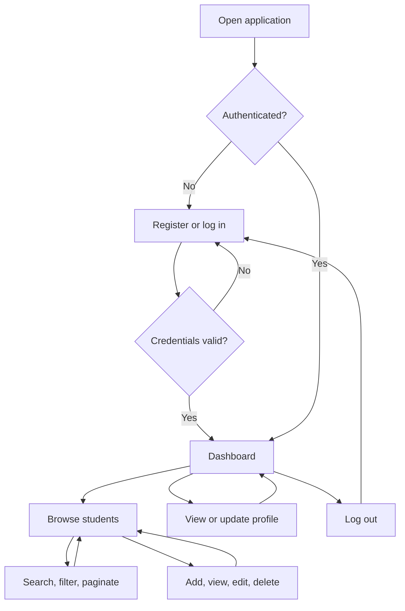

# Chapter 1 — Introduction

## 1.1 Project Context

Schools need dependable student records for identification, enrollment review, and reporting. Paper files and scattered spreadsheets make updates and searches slow and can introduce duplicate entries. The Student Information System (SIS) provides a centralized web application for authorized users to manage those records.

## 1.2 Purpose and Description

The SIS is a MERN application with a React frontend, Express API, and MongoDB database. Users register and sign in to manage student records. The application supports secure CRUD operations, search, filters, pagination, a live dashboard, and a personal profile. It is designed for desktop and mobile browsers.

## 1.3 Objectives

### General Objective

Develop a secure and responsive Student Information System that stores, retrieves, and summarizes student data accurately.

### Specific Objectives

1. Authenticate users with password hashing, JWTs, and protected routes.
2. Add, view, edit, and delete validated student records while preventing duplicate IDs.
3. Search by student ID or name, filter by course or year level, and browse paginated results.
4. Display current student totals and grouped counts from the database.
5. Let users view and update their own permitted profile information.

## 1.4 Scope and Delimitation

The system manages student ID, full name, email, course, and year level. It supports account registration, login, logout, profile name updates, and record summaries. All signed-in users can access and manage student records; role-based permissions, grades, enrollment workflows, file uploads, and notifications are outside this version. It requires a reachable MongoDB database and an environment-configured JWT secret. This project uses demonstration data and is not connected to any official school registry.

## 1.5 System Flowchart

## Documentation and submission notes

Export this chapter to Letter (8.5 × 11 inches) with 1-inch top, right, and bottom margins and a 1.5-inch left margin. Source-code screenshots: authentication middleware and routes, Student model and CRUD routes, list search/pagination, dashboard aggregation, and profile update. System screenshots: registration, login, dashboard, student list with search/filter, add/edit form, student detail, profile, and mobile navigation. Presentation: problem, objectives, architecture, feature demo, validation/security, tests, responsibilities, and limitations.
